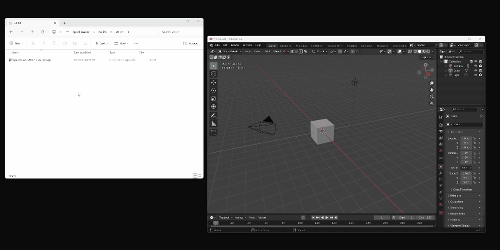

.. _installation:

#############
Installation
#############

Curve Sculpt 3D is a Blender extension and needs Blender 5.2 or later.

Drag and drop the installation zip file into Blender to install the add-on, or use
*Edit ‣ Preferences ‣ Get Extensions*, then *Install from Disk…* in the drop-down menu at the top right.

You can then follow the steps in the :ref:`Getting Started Guide<quick_start>`.

If you have any issues do not hesitate to get in touch via `info@configurate.net <mailto:info@configurate.net>`_.
